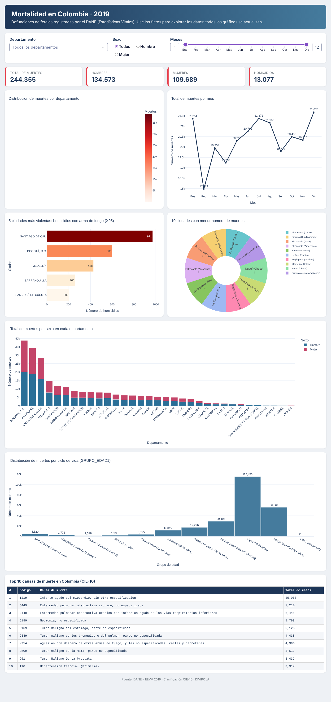
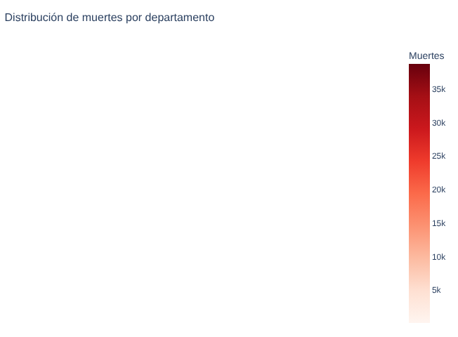
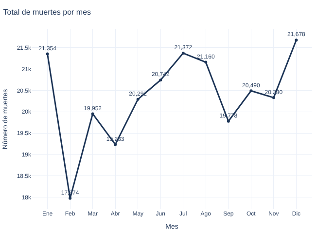
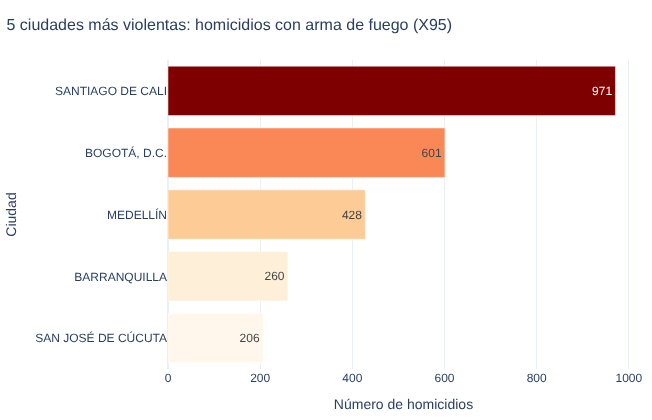
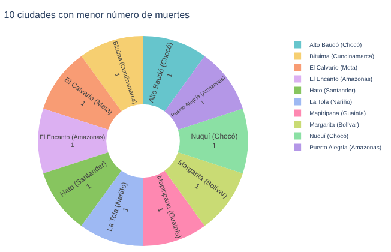
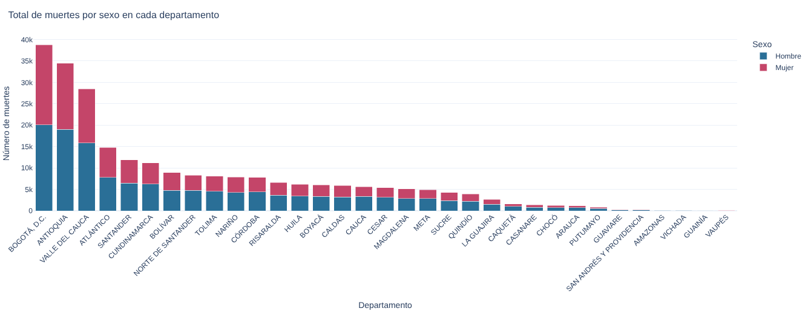
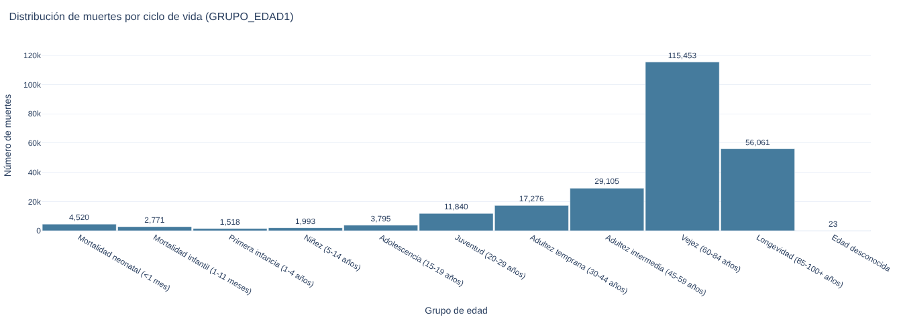
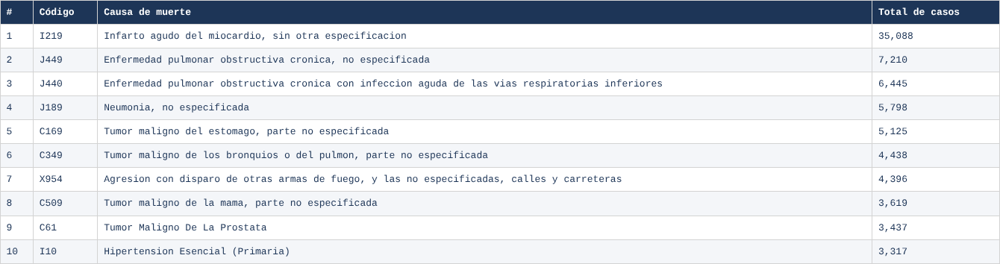

# Mortalidad en Colombia 2019 – Aplicación web interactiva (Dash)

**Estudiante:** _Giovanni Franchesco Mora Torres_
**Aplicación desplegada:** _[(URL de Render)](https://mortalidad-colombia-2019-j7re.onrender.com/)_
**Repositorio:** _[(URL de GitHub)](https://github.com/franchescomora/mortalidad-colombia-2019)_

## Introducción del proyecto
Aplicación web dinámica desarrollada en Python con **Plotly** y **Dash** que analiza los 244.355 registros de defunciones no fetales de Colombia en 2019, publicados por el DANE en las Estadísticas Vitales (EEVV). La aplicación integra mapas, gráficos y tablas interactivas para explorar los datos.

## Objetivo
Identificar patrones demográficos, temporales y regionales de la mortalidad en Colombia: dónde se concentran las muertes, cómo varían por mes, qué ciudades presentan más homicidios por arma de fuego, cuáles son las principales causas de muerte y cómo se distribuyen por sexo y por ciclo de vida.

## Estructura del proyecto
```
mortalidad-colombia-2019/
├── app.py                 # Aplicación Dash (layout, filtros y callbacks)
├── preparar_datos.py      # Convierte los .xlsx del DANE en CSV livianos para data/
├── data/
│   ├── mortalidad_2019.csv.gz  # NoFetal2019.xlsx (columnas usadas)
│   ├── codigos_muerte.csv      # CodigosDeMuerte.xlsx (CIE-10, 3 y 4 caracteres)
│   └── divipola.csv            # Divipola.xlsx (municipios, departamentos, coordenadas)
├── assets/style.css       # Estilos de la interfaz
├── capturas/              # Capturas de pantalla usadas en este README
├── requirements.txt       # Dependencias
├── Procfile               # Comando de arranque para el PaaS
└── README.md
```

## Requisitos
- Python 3.11 o superior
- dash 4.5.0 · plotly 7.1.0 · pandas 3.0.5 · gunicorn 26.2.0 (ver `requirements.txt`)

## Software
Python, Dash, Plotly Express, Pandas, Gunicorn, Git/GitHub y Render (PaaS).

## Instalación (ejecución local)
```bash
git clone https://github.com/<usuario>/mortalidad-colombia-2019.git
cd mortalidad-colombia-2019
python -m venv .venv
source .venv/bin/activate        # Windows: .venv\Scripts\activate
pip install -r requirements.txt
python app.py                    # abrir http://localhost:8050
```
Para regenerar `data/` a partir de los archivos originales del DANE:
```bash
python preparar_datos.py NoFetal2019.xlsx CodigosDeMuerte.xlsx Divipola.xlsx
```

## Despliegue en Render
1. Subir el repositorio a GitHub.
2. En [render.com](https://render.com): **New → Web Service** y conectar el repositorio.
3. Configuración:
   - **Runtime:** Python 3
   - **Build Command:** `pip install -r requirements.txt`
   - **Start Command:** `gunicorn app:server --bind 0.0.0.0:$PORT --workers 1 --timeout 120`
   - **Instance type:** Free
4. Pulsar **Create Web Service** y esperar a que el estado pase a *Live*. La URL pública queda en la forma `https://<nombre>.onrender.com`.

> En el plan gratuito el servicio se suspende tras un rato sin uso; la primera visita puede tardar unos 30–50 segundos.

## Visualizaciones con explicaciones de los resultados
La parte superior tiene **filtros por departamento, sexo y rango de meses**. Todos los gráficos, los indicadores y la tabla se recalculan con cada selección.



### 1. Mapa: muertes por departamento

Cada burbuja está en el centroide del departamento; su tamaño y color indican el total de muertes. **Bogotá D.C. (~38.800), Antioquia (~34.500) y Valle del Cauca (~28.400)** concentran casi el 42 % de las defunciones del país, lo que refleja su mayor población. Los departamentos de la Amazonía y la Orinoquía (Vaupés, Guainía, Vichada, Amazonas) registran los valores más bajos.

### 2. Gráfico de líneas: muertes por mes

La mortalidad oscila entre unas 18.000 y 21.700 muertes al mes. **Febrero es el mes más bajo (17.974)**, en parte porque solo tiene 28 días, y **diciembre el más alto (21.678)**. Hay picos en enero y julio-agosto, y un descenso en septiembre.

### 3. Gráfico de barras: 5 ciudades más violentas (X95)

Homicidios por agresión con disparo de arma de fuego (códigos CIE-10 X950–X959). **Santiago de Cali lidera con 971 casos**, por encima de Bogotá (601), que tiene casi el triple de población. Le siguen Medellín (428), Barranquilla (260) y Cúcuta (206).

### 4. Gráfico circular: 10 ciudades con menor mortalidad

Muestra los municipios con menos defunciones registradas: cada uno tiene **1 muerte en 2019**. Son municipios pequeños y apartados, como Alto Baudó y Nuquí (Chocó) o El Encanto y Puerto Alegría (Amazonas). Como muchos municipios empatan con una sola muerte, el desempate es alfabético. Este bajo número también puede reflejar subregistro en zonas rurales dispersas.

### 5. Barras apiladas: muertes por sexo en cada departamento

En casi todos los departamentos mueren más hombres que mujeres. A nivel nacional se registran **134.573 hombres (55 %) frente a 109.689 mujeres (45 %)**. La brecha es más marcada en departamentos con alta violencia, porque los homicidios afectan sobre todo a hombres jóvenes.

### 6. Histograma: distribución por ciclo de vida (GRUPO_EDAD1)

Los códigos GRUPO_EDAD1 se agrupan según la tabla de referencia de la actividad. **Vejez (60–84 años) concentra 115.453 muertes (47 %)** y Longevidad (85+) otras 56.061; es el patrón esperado de mortalidad por enfermedades crónicas. La mortalidad neonatal (4.520) es mayor que la de toda la primera infancia y la niñez juntas. Entre los 15 y 29 años hay un aumento claro, asociado a causas externas.

### 7. Tabla: 10 principales causas de muerte

| # | Código | Causa | Casos |
|---|---|---|---|
| 1 | I219 | Infarto agudo del miocardio, sin otra especificación | 35.088 |
| 2 | J449 | EPOC, no especificada | 7.210 |
| 3 | J440 | EPOC con infección aguda de vías respiratorias inferiores | 6.445 |
| 4 | J189 | Neumonía, no especificada | 5.798 |
| 5 | C169 | Tumor maligno del estómago | 5.125 |
| 6 | C349 | Tumor maligno de bronquios o pulmón | 4.438 |
| 7 | X954 | Agresión con disparo de arma de fuego (calles y carreteras) | 4.396 |
| 8 | C509 | Tumor maligno de la mama | 3.619 |
| 9 | C61 | Tumor maligno de la próstata | 3.437 |
| 10 | I10 | Hipertensión esencial (primaria) | 3.317 |

El **infarto agudo de miocardio** es, por mucho, la primera causa: causa casi 5 veces más muertes que la segunda. Las enfermedades cardiovasculares, respiratorias crónicas y los cánceres dominan la lista. El homicidio con arma de fuego (X954) es la **única causa externa** en el top 10, lo que muestra el peso de la violencia en la mortalidad del país.

## Fuente de datos
DANE – Estadísticas Vitales (EEVV) 2019: https://microdatos.dane.gov.co/index.php/catalog/696
